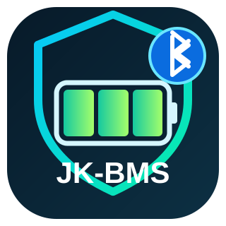

<p align="center">
  
</p>

# Smart JK-BMS Bluetooth

**Home Assistant add-on — Development version**

Monitor multiple JK-BMS batteries over **Bluetooth Low Energy** and view their readings directly in Home Assistant through MQTT Discovery.

> **Experimental software — testers welcome.** Compatibility depends on JK-BMS model and firmware. Keep the BMS hardware protections enabled; never rely on this add-on as a safety controller.

## Features

- Monitor multiple JK-BMS batteries (no fixed two-BMS limit; simultaneous connections depend on the Bluetooth adapter).
- Native Home Assistant sensors: SOC, pack voltage/current/power, cell voltages and resistances, temperatures, alarms, SOH, cycle count and available settings.
- Stable English entity names, a separate MQTT device for each BMS, and automatic reconnection.
- Built-in Node-RED for Bluetooth decoding and diagnostics.
- Supported BMS parameter changes with explicit safeguards; **read-only monitoring by default**.

## Installation

1. Install and configure **Mosquitto broker** and the Home Assistant **MQTT integration**.
2. For `local` and `hybrid` modes, ensure Bluetooth works on the Home Assistant host (built-in or USB adapter). Proxy-only mode does not require a local radio.
3. Open **Settings → Add-ons → Add-on Store → ⋮ → Repositories** and add:
   `https://github.com/tapion69/smart-jkbms-bluetooth`
4. Install **Smart JK-BMS Bluetooth (Development)**.
5. In the add-on configuration, enter your BMS Bluetooth MAC address(es) in `bms_addresses`, separated by commas, plus your MQTT username and password.
6. Save, start the add-on, then open **Settings → Devices & services → MQTT** to find the JK-BMS devices.

### Finding the Bluetooth MAC address

On Android, use a Bluetooth LE scanner such as **[nRF Connect for Mobile](https://www.nordicsemi.com/Products/Development-tools/nRF-Connect-for-mobile)**. Scan near the batteries, identify each JK-BMS, and copy its MAC address (example: `AA:BB:CC:DD:EE:FF`). Disconnect your phone from the BMS before starting the add-on.

**iOS note:** iPhones usually display an identifier rather than the actual BLE MAC. Use an Android BLE scanner or a Linux/BlueZ device when the MAC is not available.

## Set SOC calibration (v0.3.11, experimental)

A **Set SOC** number entity appears in Home Assistant only for BMS devices with verified **JK02_32S** BLE telemetry and a supported firmware. For **JK-PB inverter BMS**, firmware below **19.34** is blocked: a real JK_PB2A16S15P on hardware 15A / firmware 15.34 accepted the Bluetooth transmission but did **not** change SOC. On JK-PB hardware 19A / firmware 19.34, command `0x6E` has been verified in [ESPHome JK-BMS issue #1051](https://github.com/syssi/esphome-jk-bms/issues/1051). Compatibility of other variants is not guaranteed. Other supported JK02_32S families retain the previous firmware >=11 rule. The entity is separate from the normal SOC sensor and from the SOC0/SOC100 voltage settings.

Set SOC changes the **BMS's own** state-of-charge estimate. For example, if a battery reports 15%, entering 14% requests calibration to 14%; the SOC sensor will show 14% **only after the BMS itself reports 14%**. A reported status of "command sent" alone is *not* proof of success. The BMS may subsequently adjust its estimate.

To permit a write, first enable `allow_parameter_changes: true` in the add-on, then enable **Allow Parameter Changes** for that specific BMS in Home Assistant. Go to the BMS's Configuration entities, enter the desired percentage into **Set SOC**, and check **Last Parameter Command** for confirmation. Turn off the BMS permission switch after use. Both permissions default to off and do not persist across broker reconnects; there is also a shared 15-second write cooldown per BMS.

**Timing protection (v0.3.10):** Set SOC waits for a quiet period after the latest JK settings read (`0x96`) to avoid a possible firmware race that can silently discard writes. This does not guarantee that every JK firmware supports Set SOC. A non-confirmed command is never retried automatically.

**Caution:** Calibrating SOC may affect inverter charging/discharging logic. Only calibrate against a reliable independent reference, preferably under controlled conditions, and never as a routine correction of a guessed percentage. Incompatible/offline batteries will not expose the control; a previously published entity is removed from MQTT discovery after the device's information is confirmed. This is an experimental feature and has not yet been validated on all JK-BMS hardware/firmware variants.

## ESP32 Bluetooth Proxy (optional)

If Home Assistant is too far from your batteries, place an **ESP32 running ESPHome Bluetooth Proxy** near the JK-BMS devices. The add-on then communicates over Wi-Fi instead of using a local Bluetooth adapter.

1. Install the official firmware: [ESPHome Bluetooth Proxy](https://esphome.io/projects/?type=bluetooth).
2. Add the proxy in Home Assistant / ESPHome and make sure its native API (TCP **6053**) is reachable from the add-on.
3. In the add-on settings choose `ble_connection_mode: esphome_proxy`, enter the ESP32's LAN address in `proxy_host` and copy its `api.encryption.key` into `proxy_noise_psk`. Use an empty key **only** if the proxy API is deliberately unencrypted.
4. Keep the same `bms_addresses` and MQTT credentials; restart the add-on.

Example (with a fictitious IP and without exposing your key):

```yaml
ble_connection_mode: esphome_proxy
proxy_host: "192.168.1.100"
proxy_noise_psk: "YOUR_ESPHOME_API_ENCRYPTION_KEY"
```

An active ESPHome proxy (`bluetooth_proxy: { active: true }`) is required for JK-BMS GATT connections. The ESP32 does **not** decode the batteries: Smart JK-BMS still performs all parsing, MQTT reporting and protected parameter writes. The normal `local` mode remains the default.

**Development feature:** proxy connections and reconnection still need testing on real JK-BMS hardware. In particular, test a single BMS before adding more devices. An ESP32 usually starts with three active BLE slots.

## Hybrid mode: local Bluetooth + ESPHome proxy (v0.3.13, experimental)

With `ble_connection_mode: hybrid`, a single add-on can monitor batteries near the Home Assistant host **and** batteries near one remote ESP32 running ESPHome Bluetooth Proxy at the same time. The add-on runs two independent discovery/reconnection managers, but keeps **one MQTT publisher** with the same stable per-MAC entity IDs.

**Simplified configuration (v0.3.13):** in hybrid mode, fill only `local_bms_addresses` for the host Bluetooth adapter and `proxy_bms_addresses` for the ESP32. Separate several MAC addresses with commas. The complete BMS list is created automatically from those two fields, so `bms_addresses` may stay empty — and any old value in it is ignored while in hybrid mode. A duplicated MAC across both lists or an invalid MAC is rejected instead of connecting twice.

Example with four **fictitious** BMS addresses:

```yaml
ble_connection_mode: hybrid
bluetooth_adapter: auto
local_bms_addresses: "AA:BB:CC:DD:EE:01,AA:BB:CC:DD:EE:02"
proxy_bms_addresses: "AA:BB:CC:DD:EE:03,AA:BB:CC:DD:EE:04"
proxy_host: "192.168.1.100"
proxy_noise_psk: "YOUR_ESPHOME_API_ENCRYPTION_KEY"
persistent_connections: true
```

Make sure the host Bluetooth adapter is functional and the ESPHome active proxy (`bluetooth_proxy: { active: true }`) is reachable on TCP **6053**. The encryption key comes from the ESP32 ESPHome `api.encryption.key`; leave `proxy_noise_psk` blank only if its API intentionally has no encryption.

**Important:** there is no automatic local/proxy fallback and no cross-transport connection attempt. If an ESP32 goes offline, locally routed batteries keep running; remotely routed BMSs reconnect through their assigned proxy only. An ESP32 has a limited number of simultaneous active connections. Only **one ESPHome proxy** is supported per installation in v0.3.12.

For troubleshooting, the logs report `hybrid_routes` with the number of BMSs on each transport, as well as `persistent_manager_start` and `scan_start` events. The old `local` and `esphome_proxy` modes remain unchanged. As with all new BLE transport features, **real mixed local+proxy hardware validation is still required**.

## Main settings

| Setting | Purpose |
|---|---|
| `bms_addresses` | Comma-separated Bluetooth MACs for `local` or `esphome_proxy` mode only; ignored in `hybrid`. |
| `ble_connection_mode` | `local` (default), `esphome_proxy`, or `hybrid`. |
| `proxy_host` / `proxy_noise_psk` | ESP32 network address and encrypted ESPHome API key for proxy or hybrid mode. |
| `local_bms_addresses` / `proxy_bms_addresses` | Only these two fields are needed for BMS MAC addresses in `hybrid` mode; each MAC goes into one list. |
| `bluetooth_adapter` | `auto` (recommended) or a specific `hci0`–`hci3` in local mode. |
| `persistent_connections` | Keep sessions connected and reconnect automatically (recommended). |
| `mqtt_host` / `mqtt_port` | Usually `core-mosquitto` / `1883`. |
| `mqtt_username` / `mqtt_password` | Your MQTT broker login. |
| `allow_parameter_changes` | Master permission to modify BMS settings; **off by default**. |
| `send_bip` | Helps count how many installations are running; enabled by default and can be disabled. |
| `debug_mode` | Additional diagnostics for testing. |

For parameter changes, also enable **Allow Parameter Changes** on the individual BMS in Home Assistant. Write commands are validated and checked by readback. Leave this option disabled for monitoring.

## Troubleshooting and feedback

If a BMS connects but readings are missing, check that another app or Bluetooth integration is not connected to the same battery. If no MQTT device appears, verify broker credentials and the add-on logs.

This is a development release. Tests on different JK-BMS hardware and firmware versions are valuable! You can share your **sanitized** logs, model and firmware version through [GitHub Issues](https://github.com/tapion69/smart-jkbms-bluetooth/issues). Remove passwords, tokens, serial numbers and MAC addresses before sharing.

## Support

The add-on is **free**. Development, Bluetooth reverse-engineering and support take time. If you find it useful, a small [**Ko-fi ☕**](https://ko-fi.com/tapion69) is always appreciated — never required.

## License

Copyright © 2026 **Tapion69**.

**Free for personal and non-commercial use.** You may install the add-on and privately adapt it without a license key or prior approval. **Redistribution, rebranding, resale, publication of modified copies, and commercial integration require written permission.**

This is **source-available software, not an open-source license**. Third-party dependencies retain their own licenses. See the [LICENSE](LICENSE) file for full terms.

[Source code and updates](https://github.com/tapion69/smart-jkbms-bluetooth)
