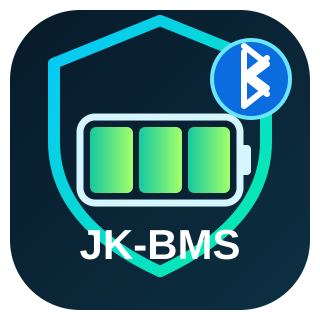

<p align="center">
  
</p>

# Smart JK-BMS Bluetooth

**Home Assistant add-on — Development version**

Monitor multiple JK-BMS batteries over **Bluetooth Low Energy** and view their readings directly in Home Assistant through MQTT Discovery.

> **Experimental software — testers welcome.** Compatibility depends on JK-BMS model and firmware. Keep the BMS hardware protections enabled; never rely on this add-on as a safety controller.

## Features

- Monitor multiple JK-BMS batteries (no fixed two-BMS limit; simultaneous connections depend on the Bluetooth adapter).
- Native Home Assistant sensors: SOC, pack voltage/current/power, cell voltages and resistances, temperatures, alarms, SOH, cycle count and available settings.
- Stable English entity names, a separate MQTT device for each BMS, and automatic reconnection.
- Built-in Node-RED for Bluetooth decoding and diagnostics.
- Supported BMS parameter changes with explicit safeguards; **read-only monitoring by default**.

## Installation

1. Install and configure **Mosquitto broker** and the Home Assistant **MQTT integration**.
2. Ensure Bluetooth works on your Home Assistant host (built-in or USB adapter).
3. Open **Settings → Add-ons → Add-on Store → ⋮ → Repositories** and add:
   `https://github.com/tapion69/smart-jkbms-bluetooth`
4. Install **Smart JK-BMS Bluetooth (Development)**.
5. In the add-on configuration, enter your BMS Bluetooth MAC address(es) in `bms_addresses`, separated by commas, plus your MQTT username and password.
6. Save, start the add-on, then open **Settings → Devices & services → MQTT** to find the JK-BMS devices.

### Finding the Bluetooth MAC address

On Android, use a Bluetooth LE scanner such as **[nRF Connect for Mobile](https://www.nordicsemi.com/Products/Development-tools/nRF-Connect-for-mobile)**. Scan near the batteries, identify each JK-BMS, and copy its MAC address (example: `AA:BB:CC:DD:EE:FF`). Disconnect your phone from the BMS before starting the add-on.

**iOS note:** iPhones usually display an identifier rather than the actual BLE MAC. Use an Android BLE scanner or a Linux/BlueZ device when the MAC is not available.

## ESP32 Bluetooth Proxy (optional)

If Home Assistant is too far from your batteries, place an **ESP32 running ESPHome Bluetooth Proxy** near the JK-BMS devices. The add-on then communicates over Wi-Fi instead of using a local Bluetooth adapter.

1. Install the official firmware: [ESPHome Bluetooth Proxy](https://esphome.io/projects/?type=bluetooth).
2. Add the proxy in Home Assistant / ESPHome and make sure its native API (TCP **6053**) is reachable from the add-on.
3. In the add-on settings choose `ble_connection_mode: esphome_proxy`, enter the ESP32's LAN address in `proxy_host` and copy its `api.encryption.key` into `proxy_noise_psk`. Use an empty key **only** if the proxy API is deliberately unencrypted.
4. Keep the same `bms_addresses` and MQTT credentials; restart the add-on.

Example (with a fictitious IP and without exposing your key):

```yaml
ble_connection_mode: esphome_proxy
proxy_host: "192.168.1.100"
proxy_noise_psk: "YOUR_ESPHOME_API_ENCRYPTION_KEY"
```

An active ESPHome proxy (`bluetooth_proxy: { active: true }`) is required for JK-BMS GATT connections. The ESP32 does **not** decode the batteries: Smart JK-BMS still performs all parsing, MQTT reporting and protected parameter writes. The normal `local` mode remains the default.

**Development feature:** proxy connections and reconnection still need testing on real JK-BMS hardware. In particular, test a single BMS before adding more devices. An ESP32 usually starts with three active BLE slots.

## Main settings

| Setting | Purpose |
|---|---|
| `bms_addresses` | Comma-separated Bluetooth MAC addresses; add one entry per BMS. |
| `ble_connection_mode` | `local` (default) or `esphome_proxy`. |
| `proxy_host` / `proxy_noise_psk` | ESP32 network address and encrypted ESPHome API key, only for proxy mode. |
| `bluetooth_adapter` | `auto` (recommended) or a specific `hci0`–`hci3` in local mode. |
| `persistent_connections` | Keep sessions connected and reconnect automatically (recommended). |
| `mqtt_host` / `mqtt_port` | Usually `core-mosquitto` / `1883`. |
| `mqtt_username` / `mqtt_password` | Your MQTT broker login. |
| `allow_parameter_changes` | Master permission to modify BMS settings; **off by default**. |
| `send_bip` | Helps count how many installations are running; enabled by default and can be disabled. |
| `debug_mode` | Additional diagnostics for testing. |

For parameter changes, also enable **Allow Parameter Changes** on the individual BMS in Home Assistant. Write commands are validated and checked by readback. Leave this option disabled for monitoring.

## Troubleshooting and feedback

If a BMS connects but readings are missing, check that another app or Bluetooth integration is not connected to the same battery. If no MQTT device appears, verify broker credentials and the add-on logs.

This is a development release. Tests on different JK-BMS hardware and firmware versions are valuable! You can share your **sanitized** logs, model and firmware version through [GitHub Issues](https://github.com/tapion69/smart-jkbms-bluetooth/issues). Remove passwords, tokens, serial numbers and MAC addresses before sharing.

## Support

The add-on is **free**. Development, Bluetooth reverse-engineering and support take time. If you find it useful, a small [**Ko-fi ☕**](https://ko-fi.com/tapion69) is always appreciated — never required.

## License

Copyright © 2026 **Tapion69**.

**Free for personal and non-commercial use.** You may install the add-on and privately adapt it without a license key or prior approval. **Redistribution, rebranding, resale, publication of modified copies, and commercial integration require written permission.**

This is **source-available software, not an open-source license**. Third-party dependencies retain their own licenses. See the [LICENSE](LICENSE) file for full terms.

[Source code and updates](https://github.com/tapion69/smart-jkbms-bluetooth)
